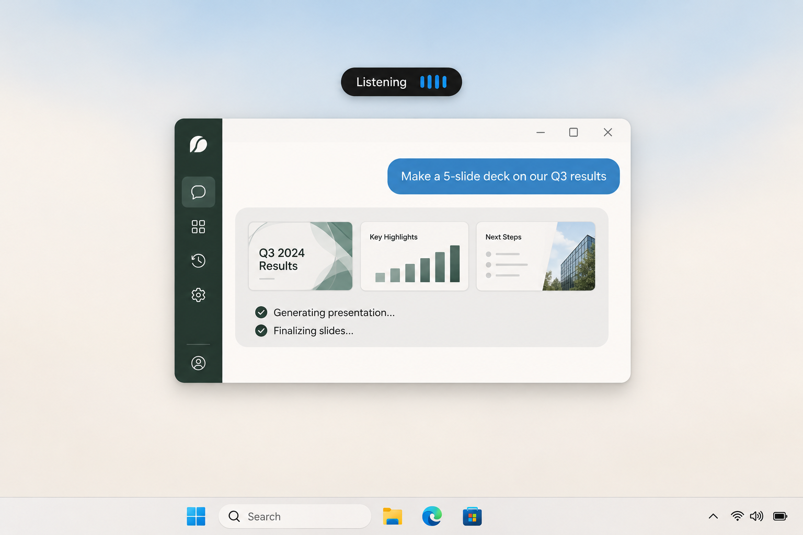

# Ambient for Windows

  

**Ambient lives at the top of your Windows desktop. Hold <kbd>Alt</kbd> + <kbd>Space</kbd> and speak naturally, or just type.** 
**It browses the web, makes presentations and documents, and gets the job done your way.**

## Download (beta)

[**Download Ambient for Windows (x64, beta) →**](https://github.com/aryansid/Ambient-Releases/releases/latest/download/Ambient-Windows-Beta-x64.zip)

About 700 MB. This link always gives the newest beta.

## Install

1. Right-click the downloaded zip, choose **Extract All**, and extract it to `C:\`.
2. Open the new folder and double-click **Start Ambient.cmd**.
3. This beta is unsigned, so Windows may show **Windows protected your PC**. Choose **More info**, then **Run anyway**.
4. Create your account and follow the setup steps. To let Ambient use Chrome, the app walks you through adding its Chrome extension (Developer mode, then **Load unpacked**).

> [!NOTE]
> This is an early beta. Expect rough edges.
