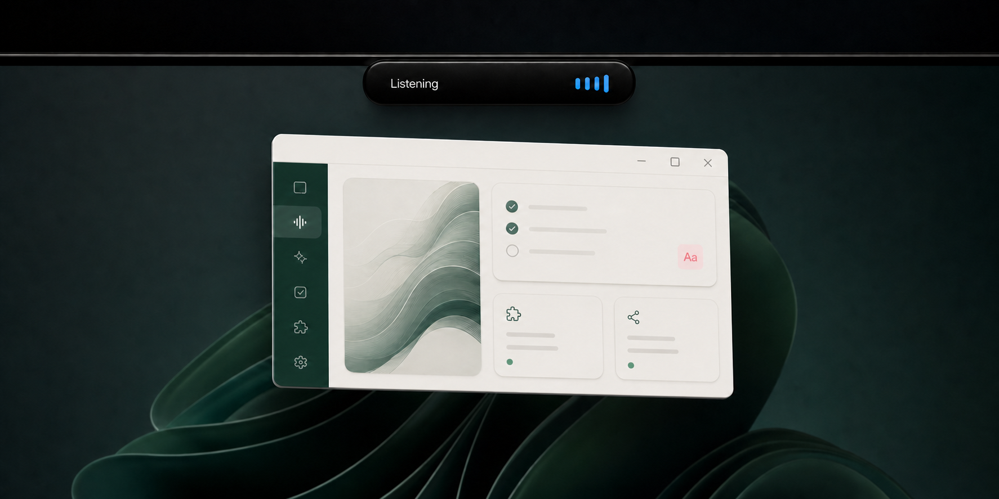

# Ambient for Windows

  

Ambient is an AI assistant that lives quietly in the background, ready to help you speak, write, and get things done across Windows. Hold a shortcut, say what you need, and keep moving.

## Windows beta

[**Download Ambient for Windows 11 (x64) →**](https://github.com/aryansid/Ambient-Releases/releases/latest/download/Ambient-Windows-x64-Setup.exe)

> [!NOTE]
> This beta is unsigned, so Windows SmartScreen may show **Unknown publisher**. Choose **More info**, confirm the filename is `Ambient-Windows-x64-Setup.exe`, then choose **Run anyway**.

[Verify the SHA-256 checksum](https://github.com/aryansid/Ambient-Releases/releases/latest/download/SHA256SUMS.txt) before launch.
